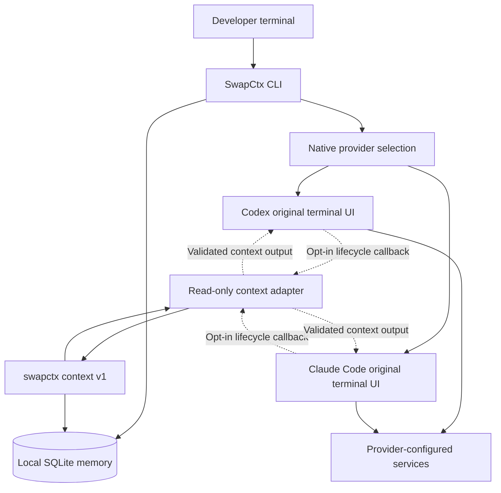

<div align="center">

# SwapCtx

**Persistent project memory for AI coding agents.**

Keep requirements, decisions and notes across sessions.<br>
Work in the original Codex or Claude Code terminal interface.

[](https://github.com/rehnx/SwapCtx/actions/workflows/ci.yml)
[](LICENSE)
[](docs/WINDOWS_RELEASE.md)

[Get started](#quick-start) · [Install](#installation) · [How it works](#how-memory-works) · [Documentation](#documentation) · [Contributing](CONTRIBUTING.md)

</div>

SwapCtx is a Windows-first Rust CLI with a local SQLite store. Save the knowledge
you want to keep, retrieve a scoped context packet, and optionally make it
available through native provider lifecycle hooks. It provides **external
memory**, not a larger model context window or guaranteed instruction adherence.

> **Preview preparation — public release not yet approved:** Local offline memory storage, CLI context retrieval, transactional database safety, and adapter hook outputs are verified deterministically with fake providers and synthetic events. Actual receipt by live native AI agents and model adherence remain unverified experimental integrations. The build badge links to CI workflow runs and is not local test evidence.

---

## Your terminal. Your provider.

Run `swapctx` to choose a provider. This static excerpt shows SwapCtx's own menu;
it is not a recording of an authenticated provider session.

```text
PS> swapctx
SwapCtx — choose your coding agent

  1  Codex
  2  Claude Code
  q  Quit (or press Enter)

Select: 1
Expose selected SwapCtx project memory to this provider? [y/N]: n
```

SwapCtx then hands the terminal to the installed provider's original UI.
Answering No shares no SwapCtx memory. Use explicit commands to skip the menu:

```powershell
# Original provider UI; no SwapCtx context sharing.
swapctx native codex
swapctx native claude

# Opt into read-only context hooks for this invocation.
swapctx native codex --context
swapctx native claude --context
```

Install and authenticate providers separately. Context mode needs Node.js 24+
and the documented hook capabilities. A failed compatibility probe falls back to
ordinary native launching with a warning. A supported integration with invalid
or incomplete context fails closed. See [native setup and limits](docs/PHASE8_NATIVE_PROVIDERS.md).

---

## Key Capabilities

Long conversations, compaction and new sessions can leave useful constraints
outside an agent's current input. SwapCtx stores deliberately saved knowledge
outside the conversation and retrieves it again when requested. The provider
still controls its context window, lifecycle and model requests.

| Capability | What you get |
| --- | --- |
| Local project memory | Requirements, decisions and notes in SQLite; no external service required for storage or retrieval. |
| Traceable lifecycle | Self-reported origins, retained history, review/expiry, invalidation, conflicts and supersession. |
| Scoped retrieval | Versioned JSON, relevance ranking, byte budgets and explicit mandatory-coverage reporting. |
| Memory intelligence | Permanent project intent, read-only health audit, and explanations of local context inclusion and omissions. |
| Worktree evidence | Git boundary inspection, staged/worktree secret heuristics, strict verification and content-bound SHA-256 fingerprints. These are local snapshot checks. |
| Agent handoffs | Preview and transactionally apply reviewed JSON knowledge bundles; decisions and notes are explicit export options. |
| Native workflows | Original Codex and Claude Code UIs; optional lifecycle context adapter without editing provider settings or instruction files. |
| Context continuity | Fresh validated snapshots on supported startup, resume, clear, compact and fork callbacks; no stale-text fallback. |
| Boundary checks | Persistent deny/ask/audit rules evaluated on request. These do not intercept or prevent file writes. |
| Recovery | Consistent whole-store backup, new-directory restore and project export/import. Diagnostics inspect without silently repairing data. |

---

## Architecture



Storage and retrieval stay local. When sharing is enabled, the provider may send
supplied memory to its configured services and retain it under its own policies.
The existing managed Codex console remains a separate optional workflow.

---

## Installation

### Use a locally prepared Windows candidate

The portable x64 package needs no Rust, Node or compiler for core commands.
Public downloads and package-manager installation are not provided by this
checkout. WinGet and Scoop packages have not been submitted.

For a candidate you built or obtained from a trusted maintainer, verify
`install-windows.ps1` and the ZIP against hashes obtained through a trusted
channel. Checksums alone do not authenticate the publisher. From its directory:

```powershell
Get-FileHash .\install-windows.ps1 -Algorithm SHA256
Get-FileHash .\swapctx-0.1.0-windows-x64.zip -Algorithm SHA256
$ExpectedZipSha256 = Read-Host 'Paste the trusted 64-digit ZIP SHA-256'
powershell.exe -NoProfile -ExecutionPolicy Bypass -File .\install-windows.ps1 `
  -Archive .\swapctx-0.1.0-windows-x64.zip -ExpectedSha256 $ExpectedZipSha256 `
  -Destination "$env:LOCALAPPDATA\SwapCtx-0.1.0"

# Enable the command in this terminal session.
$env:PATH = "$env:LOCALAPPDATA\SwapCtx-0.1.0;$env:PATH"
Get-Command swapctx -CommandType Application
swapctx --version
```

The destination must be new; its parent must exist. The installer verifies the
payload without running it and does not change PATH or user data. The execution
policy flag applies only to that process and does not establish trust. For
persistent command lookup, add the installation directory to your **user Path**
using Windows environment-variable settings, then open a new terminal.
[Installation, upgrades and uninstall](docs/WINDOWS_RELEASE.md).

### Build from source

Use the pinned Rust 1.99.0 toolchain and Microsoft C++ Build Tools with the
**Desktop development with C++** workload and Windows SDK. Bundled SQLite needs
a C compiler. Dependency provisioning can require network access.

```powershell
cargo build --locked --release
$env:PATH = "$(Resolve-Path .\target\release);$env:PATH"
swapctx --version
```

This development build can depend on the VC runtime. For the independently
compared static-runtime portable build, use the
[local release procedure](docs/RELEASE_PREPARATION.md).

---

## Quick start

From any project directory, after installing SwapCtx:

```powershell
# 1. Initialize project memory in current directory
swapctx init

# 2. Add deliberate requirements and decisions
swapctx memory add --kind requirement --key compatibility --source 'project specification' 'Preserve public interfaces'
swapctx memory add --kind decision 'Use the existing SQLite store'

# 3. Search and view context packet
swapctx memory search 'interfaces'
swapctx context --protocol-version 1 --query 'interfaces' --max-bytes 8192

# 4. Check project status and memory integrity
swapctx status
swapctx doctor
```

When ready to work with an installed provider, launch its UI with
`swapctx native codex` or opt into memory with `swapctx native codex --context`.
Use `claude` for Claude Code. Legacy `swapctx launch codex` and
`swapctx launch claude` remain plain native launchers with no context injection.

Use `swapctx --help` and `swapctx memory --help` for command discovery.
[Memory lifecycle, policies and recovery examples](docs/USAGE.md).

For daily work, use `intent` to preserve permanent requirements, `memory audit`
to find stale or competing knowledge, and `explain` to understand what fits in a
local context packet. Before switching agents, preview a `handoff`; before review,
use `inspect` and `verify` to collect local Git and memory evidence.
[Daily workflow and command contracts](docs/INTELLIGENCE_WORKFLOWS.md).

---

## How memory works

1. **Register a project.** `init` registers exactly the current directory. Commands
   in nested directories select the nearest registered ancestor; separately
   registered child projects have their own records and rules.
2. **Save deliberately.** Records have self-reported provenance and retained
   lifecycle history. Nothing automatically scans files or ingests conversations.
3. **Retrieve a snapshot.** Context selection prioritizes requirements and reports
   incomplete coverage. Default retrieval excludes stale, conflicting, invalid,
   unknown-provenance and secret-like records. Budgets count UTF-8 bytes, not tokens.
4. **Refresh when requested.** In opt-in native mode, each supported callback reads
   and validates current memory. Identical earlier snapshots never suppress
   resume or compaction recovery. A failed fresh read does not reuse old text.

“Context prepared” means local validation succeeded. “Output written” means the
adapter completed a local write. Neither proves provider receipt, retention or
model adherence. SwapCtx cannot detect every compaction or inspect hidden model
state. [Context protocol](docs/CONTEXT_PROTOCOL.md) · [Continuity contract](docs/PHASE9_CONTEXT_CONTINUITY.md).

---

## Privacy and security

SwapCtx's storage/retrieval core has no network client, telemetry or background
service. Data defaults to `%LOCALAPPDATA%\SwapCtx`; `--data-dir` selects another
store. **Memory, backups and exports are plaintext**, protected by local account
permissions. Secret detection is heuristic, and provenance is not authenticated.

Context sharing is explicit. Native integration does not change `AGENTS.md`,
`CLAUDE.md`, provider settings, permissions or authentication. Providers retain
their own processing and history behavior. Manual boundary policies do not
enforce filesystem access, and an `ask` result opens no approval workflow.

Run `swapctx privacy` or `swapctx capabilities` for local capability reporting.
See [security boundaries and reporting](SECURITY.md) before sharing sensitive data.

---

## Compatibility and requirements

| Workflow | Requirements and evidence |
| --- | --- |
| Memory, search, context, policies, backup/recovery | Windows x64 portable CLI; core needs no Node, Rust or AI provider at runtime. |
| Plain native launch | Separately installed provider: native `.exe` or a validated standard npm package entry. JS entries need Node; legacy `launch` also supports trusted `.cmd`/`.bat` shims. |
| Native Codex context | Node.js 24+; recognizable Codex version and help advertising `--config` plus the modern hook-trust capability. No minimum compatible release or exact certified version established. Trust is never bypassed. |
| Native Claude context | Node.js 24+; probe admits major 2 from 2.1.296 with `--plugin-dir`. This admission floor is not a verified supported-version range. |
| Managed Codex console | Separate existing app-server workflow pinned to Codex CLI 0.162.1 and Node.js 24+; [setup and evidence](docs/PHASE5_EVERYDAY_CODEX.md). |

Native context mode forwards supported arguments after `--`, but refuses workspace
relocation and conflicting configuration overrides. Unsupported probes fall back
with a warning. Passing a probe does not establish working hooks. See the
[exact provider contracts and restrictions](docs/PHASE8_NATIVE_PROVIDERS.md).
Non-Windows release compatibility has not been established by local Windows tests.

---

## Project status

| Area | Current evidence |
| --- | --- |
| Core, recovery and native adapter contracts | Deterministic local Rust/Node tests, synthetic lifecycle events and fake providers. |
| Native provider receipt and adherence | Unverified with real native providers; no general recovery guarantee. |
| Managed-console model use | A historical authenticated pilot passed its specific checks; it does not validate the newer native route or natural compaction recovery. |
| Portable distribution | Local candidate preparation and acceptance; see the [current release assessment](docs/PHASE11_RELEASE_READINESS.md). |
| Public release | Approval pending. Hosted acceptance, clean-machine evidence, advisory review and publisher identity remain release decisions. |

Current integration evidence and remaining release work are recorded in the
[unified integration report](docs/UNIFIED_INTEGRATION.md). Release review,
distribution trust and independently verified native compatibility remain gates.
There is no automatic conversation capture.

---

## Documentation

- **Installation & Operations**: [Windows installation](docs/WINDOWS_RELEASE.md) · [CLI usage & recovery](docs/USAGE.md) · [Release preparation](docs/RELEASE_PREPARATION.md)
- **Integrations**: [Native provider setup](docs/PHASE8_NATIVE_PROVIDERS.md) · [Managed Codex console](docs/PHASE5_EVERYDAY_CODEX.md)
- **Protocols & Quality**: [Context protocol](docs/CONTEXT_PROTOCOL.md) · [Continuity contract](docs/PHASE9_CONTEXT_CONTINUITY.md) · [Memory quality](docs/MEMORY_QUALITY.md)
- **Launch decision**: [Current readiness and gates](docs/LAUNCH_READINESS.md) · [Release-note draft](docs/RELEASE_NOTES_0.1.0.md)
- **Security & Readiness**: [Security hardening](docs/PHASE10_PRODUCTION_HARDENING.md) · [Release readiness report](docs/PHASE11_RELEASE_READINESS.md) · [Local evidence](docs/evidence/phase11-release-preparation.json)

---

## Community & Contributing

We welcome contributions! Please review our contributor and community guidelines:
- [Contributor Guide (`CONTRIBUTING.md`)](CONTRIBUTING.md) — Setup, guidelines, architecture map, and verification instructions.
- [Code of Conduct (`CODE_OF_CONDUCT.md`)](CODE_OF_CONDUCT.md) — Standards for respectful community participation.
- [Support & Troubleshooting (`SUPPORT.md`)](SUPPORT.md) — Common diagnostic steps and issue reporting guidelines.
- [Security Policy (`SECURITY.md`)](SECURITY.md) — Vulnerability reporting and trust boundaries.
- [Project Roadmap (`docs/ROADMAP.md`)](docs/ROADMAP.md) — Upcoming priorities and community contribution opportunities.
- [Changelog (`CHANGELOG.md`)](CHANGELOG.md) — Historical release changes and notes.

SwapCtx is licensed under [Apache-2.0](LICENSE). Dependency authors and licenses
are acknowledged in [third-party notices](THIRD_PARTY_NOTICES.txt) and the
[dependency guide](docs/DEPENDENCIES.md). Codex and Claude Code are separate
products of their respective owners; SwapCtx is an independent project.

---

## FAQ

**Does SwapCtx increase the model's context window?**<br>
No. It stores external records and retrieves selected information into the
provider's existing context budget.

**Does it work fully offline?**<br>
Core memory, retrieval, policies and recovery do. Building may download
dependencies; provider sessions use the provider's configured services.

**Does it record every coding conversation?**<br>
No. Knowledge is saved explicitly. Native adapters do not collect transcripts.

**Does context injection guarantee adherence?**<br>
No. Local preparation and successful output do not prove receipt or model use.

**Does it replace Codex or Claude Code?**<br>
Native mode opens the original UI. The older managed Codex console is a separate
optional command family.

**Does it stop agents from modifying files?**<br>
No. Policies are manual checks, not filesystem enforcement or approval grants.
