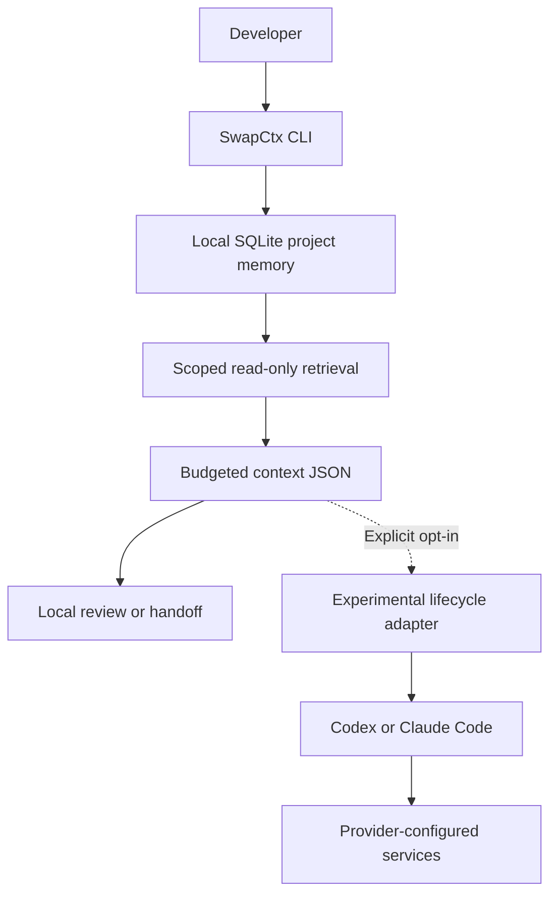

             # SwapCtx

**Local-first project memory for AI coding agents.**

Keep requirements, decisions, and notes across sessions. Retrieve the knowledge
your next task needs from a local SQLite store, with optional sharing to Codex
or Claude Code.

[](https://github.com/rehnx/SwapCtx/releases/tag/v0.1.0-preview)
[](https://github.com/rehnx/SwapCtx/actions/workflows/ci.yml)
[](LICENSE)
[](docs/WINDOWS_RELEASE.md)

**[Download Windows ZIP](https://github.com/rehnx/SwapCtx/releases/download/v0.1.0-preview/swapctx-0.1.0-preview-windows-x64.zip)**
 · [Quick start](#quick-start) · [Documentation](docs/README.md) · [Contribute](CONTRIBUTING.md)

Long conversations, compaction, and new sessions can leave important constraints
outside an agent's current input. SwapCtx gives you a place to save that knowledge
deliberately and retrieve it again. It provides **persistent external memory**;
it does not expand a model's native context window or guarantee AI adherence.

> **Public Windows preview:** [v0.1.0-preview](https://github.com/rehnx/SwapCtx/releases/tag/v0.1.0-preview)
> is available for Windows x64. Core memory and recovery workflows have deterministic
> Windows test coverage. Optional native provider integrations remain experimental.
> The binary is unsigned; memory and exports are plaintext. See [security](#privacy-and-security).

## Why use SwapCtx?

- **Save knowledge explicitly.** Keep project requirements, decisions, and notes
  without automatically collecting conversations or transcripts.
- **Keep projects separate.** Retrieval selects the nearest registered project;
  separately registered nested projects have their own memory and rules.
- **Review what changes.** Retain origins and history when reviewing, expiring,
  invalidating, archiving, or superseding records. Origins are self-reported.
- **Retrieve bounded context.** Generate versioned JSON with relevance ranking,
  byte budgets, exclusions, and explicit mandatory-requirement coverage.
- **Carry knowledge forward.** Preview and apply JSON handoffs, or use SQLite
  backup, restore, and project export/import for recovery and transfer.

Storage and retrieval need no cloud service, AI subscription, Node.js, or Rust
installation at runtime. Search uses literal substrings; context retrieval uses
local ranking, with no embedding service.

## Installation

Download the official
[Windows x64 ZIP](https://github.com/rehnx/SwapCtx/releases/download/v0.1.0-preview/swapctx-0.1.0-preview-windows-x64.zip),
[PowerShell installer](https://github.com/rehnx/SwapCtx/releases/download/v0.1.0-preview/install-windows.ps1),
and [checksums](https://github.com/rehnx/SwapCtx/releases/download/v0.1.0-preview/SHA256SUMS.txt)
from **v0.1.0-preview**. Follow the
[Windows installation guide](docs/WINDOWS_RELEASE.md) to verify both downloads,
install into a new directory, and enable command lookup.

The portable core requires no administrator privileges or development tools.
You can also verify and extract the ZIP manually. Checksums detect changed bytes;
they do not independently authenticate the publisher.

**Public release support is Windows x64.** There are no official WinGet or Scoop
packages, Linux or macOS binaries, or stable-production support commitments.
For source builds, use the [contributor setup](CONTRIBUTING.md#development-setup)
and the pinned Rust toolchain in [rust-toolchain.toml](rust-toolchain.toml).

## Quick start

After installation, open PowerShell in a project directory. These commands stay
local and do not start an AI provider:

```powershell
# Register this directory as a project.
swapctx init

# Save a requirement and a decision.
swapctx memory add --kind requirement --key compatibility --source 'project specification' 'Preserve public interfaces'
swapctx memory add --kind decision 'Use the existing SQLite store'

# Find saved knowledge and retrieve a bounded JSON context packet.
swapctx memory search 'interfaces'
swapctx context --protocol-version 1 --query 'interfaces' --max-bytes 8192

# Inspect the selected project and stored-data integrity.
swapctx status
swapctx doctor
```

For example, adding the first memory in a fresh store prints:

```text
Saved local memory record #1
```

Record IDs depend on your store. The context packet reports selected records and
`coverage.mandatory_context_complete`; check coverage as well as command success.
Producing this JSON does not send it to a provider.

Default data lives in `%LOCALAPPDATA%\SwapCtx`, outside your project and executable
directory. Use the same global `--data-dir` option on every command if you choose
another store. No project files are scanned automatically by initialization.

Next: [memory lifecycle and recovery](docs/USAGE.md) ·
[intent, health audits, and handoffs](docs/INTELLIGENCE_WORKFLOWS.md).

## How memory works

Save selected knowledge, retrieve it for the registered project, then decide
whether to share it. There is no automatic transcript ingestion.



Retrieval reports stale, conflicting, sensitive-looking, or ineligible records
and incomplete mandatory coverage. Native callbacks request fresh scoped context;
failed validation withholds context rather than reusing a stale packet.
Providers control their hooks, trust decisions, model requests, and context windows.

## Optional provider integrations

Keep the provider's original terminal UI:

```powershell
# Ordinary native launch; no SwapCtx memory sharing.
swapctx native codex
swapctx native claude

# Explicitly opt into experimental context sharing for this invocation.
swapctx native codex --context
swapctx native claude --context
```

Install and authenticate providers separately. Context sharing requires **Node.js
24+**, the documented hook capabilities, and normal provider trust. Plain native
EXE launching needs no Node; standard npm JavaScript entries still need Node.
An unsupported compatibility probe warns and falls back to plain native launch.
Invalid or incomplete context on a supported integration fails closed.

Bare `swapctx` also offers an interactive selector. This is a static menu excerpt:

```text
SwapCtx — choose your coding agent

  1  Codex
  2  Claude Code
  q  Quit (or press Enter)

Expose selected SwapCtx project memory to this provider? [y/N]:
```

**Synthetic tests establish local adapter behavior, not live-provider compatibility,
context receipt, or model adherence.** No exact native-provider release is certified.
See [native setup and limitations](docs/PHASE8_NATIVE_PROVIDERS.md) and
[the open compatibility work](https://github.com/rehnx/SwapCtx/issues/7).
The older [managed Codex console](docs/PHASE5_EVERYDAY_CODEX.md) is a separate,
optional workflow with its own version requirements and historical evidence.

## Privacy and security

- The storage/retrieval core has no network client, telemetry, background service,
  or automatic transcript collection.
- **Memory, backups, exports, and handoffs are plaintext.** Inspect them before
  sharing. Secret detection is heuristic and can miss sensitive information.
- Opting into context sharing exposes selected memory to the provider and
  potentially its configured services and history.
- Native setup does not modify provider settings, `AGENTS.md`, or `CLAUDE.md`,
  or bypass provider trust.
- Manual boundary rules and worktree checks are advisory observations. They do
  not intercept file writes or enforce filesystem permissions.
- The preview binary is unsigned. Checksums and state fingerprints are not
  signatures, security certification, or proof of publisher identity.

Read the [security policy](SECURITY.md) for boundaries and
[private vulnerability reporting](https://github.com/rehnx/SwapCtx/security/advisories).
For release-specific hashes, CI evidence, and acceptance limitations, see the
[published-asset verification record](docs/RELEASE_VERIFICATION.md).

## Documentation

| I want to… | Start here |
| --- | --- |
| Install, upgrade, or uninstall | [Windows guide](docs/WINDOWS_RELEASE.md) |
| Use memory, context, policies, or recovery | [CLI usage](docs/USAGE.md) |
| Audit memory or transfer knowledge between agents | [Daily workflows](docs/INTELLIGENCE_WORKFLOWS.md) |
| Configure optional native sharing | [Provider setup](docs/PHASE8_NATIVE_PROVIDERS.md) |
| Understand architecture or build an adapter | [Documentation index](docs/README.md#architecture-and-contracts) |
| Troubleshoot or report a bug | [Support](SUPPORT.md) |

The [complete documentation index](docs/README.md) separates current user guides
from historical engineering and release-preparation evidence.

## Contributing and support

Documentation fixes, focused bug reports, synthetic test cases, and feature
proposals are welcome. Read [CONTRIBUTING.md](CONTRIBUTING.md) for setup, first
contributions, and deterministic verification. Participate under the
[community conduct guidelines](CODE_OF_CONDUCT.md).

Use [GitHub Issues](https://github.com/rehnx/SwapCtx/issues) for non-sensitive bugs
and ideas; see [SUPPORT.md](SUPPORT.md) for safe diagnostics. There is no guaranteed
response time or support period. Future work is tracked in the [roadmap](docs/ROADMAP.md).

Licensed under [Apache-2.0](LICENSE). Bundled dependency notices are in
[THIRD_PARTY_NOTICES.txt](THIRD_PARTY_NOTICES.txt).
